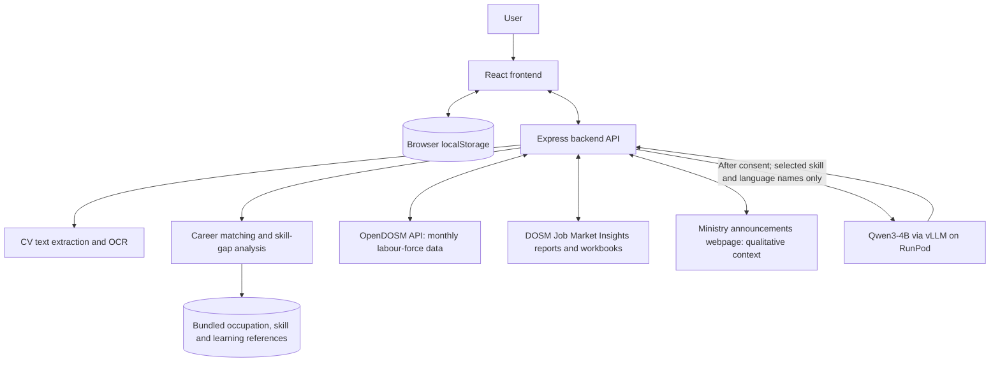

# FutureReady

**Career exploration and learning planning for students and job seekers.**

FutureReady helps users review skills identified from a CV, explore career options, understand possible skill gaps, and plan learning activities. It is a decision-support prototype—not a hiring decision, a prediction of employment outcomes, professional advice, or proof of a person's qualifications.

> **For judging:** Use fictional examples or a sample CV without real personal information. Demo data and planning scenarios are labelled where applicable.

## Team Information

| Field | Details |
| --- | --- |
| Team name | Chili Raccoon 7 |
| Domain | Education Technology (EdTech) & Workforce Development |
| SDG track | SDG 4 — Quality Education |
| Project name | FutureReady |
| Team leader | [Shiu Jun Ming](https://github.com/JmShiu06) ([`JmShiu06`](https://github.com/JmShiu06)) |
| University | Xiamen University Malaysia (XMUM) |
| Team size | 5 members |

## Project Links

| Resource | Link / status |
| --- | --- |
| GitHub repository | <https://github.com/JmShiu06/FutureReady> |
| Replit workspace | <https://replit.com/@shiujm2007/FutureReady> |
| Live demo | <https://future-ready-workforce-shiujm2007.replit.app> |
| Slide deck | <https://canva.link/065dwvdzjbe0fzb> |
| Demo video | <https://youtu.be/vNEGPrsNgKE> |

## The Problem

Students and early-career job seekers may find it difficult to understand which skills are relevant to a career and how to improve gaps in their current profile. Career requirements, labour-market information, and learning resources are spread across different sources.

## Our Solution

FutureReady brings career exploration, CV-based skill review, skill-gap analysis, learning planning, and labour-market context into one web application. It combines bundled career and skill references with selected official Malaysian data sources. Qwen3-4B, served through RunPod, can provide explanations for selected skills when the user gives consent.

## Key Features

- **CV skill review:** Upload a supported CV file. The backend extracts text from PDF/DOCX documents and uses OCR for supported images. Users review and confirm the detected skill information.
- **Career matching:** Compare selected skills with the application's occupation and skill references. Match scores represent reference overlap, not hiring probability or verified ability.
- **Skill-gap analysis and learning plans:** Review missing skills and follow a roadmap using the existing resource catalogue and clearly labelled self-directed practice suggestions.
- **Career and labour-market insights:** Explore DOSM job-offering figures at broad occupation-group level and monthly labour-force context from OpenDOSM.
- **Future-role planning scenarios:** Compare Moderate and Fast AI-disruption scenarios. Their weights and task assumptions are app-authored planning assumptions, not measured forecasts of job losses.
- **Government announcements:** View dated Ministry of Digital Malaysia announcements as qualitative policy context. These announcements are not treated as measured skill-demand data.
- **Job Search demonstration:** Uses fictional sample listings; the current prototype does not connect to a live vacancy API.

## Technology Stack

| Layer | Technology / service |
| --- | --- |
| Frontend | React 19, TypeScript, Vite 7, Tailwind CSS 4, Wouter, Radix UI |
| Backend | Node.js 20, Express 5, REST API, Zod validation |
| CV processing | `pdf-parse`, `pdfjs-dist`, Mammoth, Multer, Tesseract.js and English OCR data |
| AI explanations | Qwen3-4B served by vLLM on a RunPod GPU Pod |
| Hosting / development | Replit |
| Source control | GitHub |
| Browser-side storage | `localStorage` for profile, selected skills, preferences and learning progress |
| Production database | No active production database is connected in the current prototype |

## Architecture



The uploaded CV is processed by the Replit-hosted backend. The raw CV file and full extracted CV text are not sent to RunPod. The AI explanation context uses selected skill and language names; the application keeps matching scores and approved reference information under server-side control. Profile information and learning progress are mainly stored in the user's browser.

## Data Sources and Interpretation

- **OpenDOSM:** Official monthly Labour Force Survey data for labour-market context.
- **DOSM Job Market Insights:** Official release pages and workbooks, including Table 2 online job-offering counts for broad occupation groups. These counts do not represent all vacancies or specific skill demand.
- **Ministry of Digital Malaysia:** Public announcements are used for qualitative context only. The page can limit automated requests or become temporarily unavailable.
- **O*NET 31.0 and MyCOL:** Occupation and skill references with different geographic scopes. US O*NET skill data is not Malaysian employment statistics.
- **Static job-title / skill references:** Bundled reference data is not a live vacancy feed and should not be treated as a time series of skill demand. Check the original source and licence for the job-title CSV before redistribution.
- **Learning resources:** The app uses a curated catalogue and links to provider materials where available. Some gaps are addressed through app-authored self-directed practice, not invented courses or certificates.
- **Synthetic examples:** Synthetic profiles, scenario snapshots and demonstration figures must remain labelled as fictional and must not be presented as real workforce measurements.

### Transparent scoring and limitations

- Career-match percentages measure overlap between selected/documented skills and the application's skill references; they do not estimate the chance of being hired.
- Job-market signals are based on broad occupation groups and may vary by quarter or season.
- Moderate/Fast scenario results depend on disclosed app-authored assumptions. They are not validated predictions of future employment or automation.
- CV extraction/OCR can miss information. Users should review detected skills and only confirm information that is accurate.
- AI explanations can be incomplete or incorrect. Do not treat them as verified qualifications or professional advice.

## Privacy and Safe Demonstration

- Use a fictional CV or a sample with real personal details removed during judging.
- CV files are uploaded to the backend for text extraction/OCR and are processed in memory by the current application flow.
- The raw CV file, full extracted text, name, contact details and narrative are not sent to the RunPod AI explanation service.
- AI explanation requests require consent and use selected skill and language names in the model context.
- Profile information and learning progress stored in browser `localStorage` remain on that browser/device until cleared by the user or browser.
- Do not commit API keys or passwords. Keep required credentials in server-side Replit Secrets.

## How to Run and Verify

Option 1 — Run on Replit (Recommended)
Open the Replit Project, or import this repository via Create Repl → Import from GitHub.
Click Run. Replit uses the .replit file to start python src/main.py.

The repository is a **pnpm TypeScript workspace**. In Replit, open the project and use its configured **Run** workflow. To install dependencies in a compatible Node.js 20 environment:

```bash
pnpm install --frozen-lockfile
```

For local development, the API and frontend have separate workspace scripts. Start them in separate terminals after installing dependencies:

```bash
pnpm --filter @workspace/api-server run dev
pnpm --filter @workspace/future-ready-workforce run dev
```

The RunPod explanation feature also requires the correct server-side model endpoint settings and credentials. Configure them through Replit Secrets; never paste secret values into this README or commit them to GitHub.

### Verification commands

```bash
pnpm run typecheck:libs
pnpm --filter @workspace/api-server run typecheck
pnpm --filter @workspace/future-ready-workforce run typecheck
pnpm --filter @workspace/api-server test
pnpm --filter @workspace/future-ready-workforce run test:domain
PORT=5173 BASE_PATH=/ pnpm --filter @workspace/future-ready-workforce run build
```

Automated AI tests use synthetic fixtures and a mock provider. Passing those tests does not prove that live Qwen generation or every real-world CV/OCR case has been verified. Re-run the checks before submission and update this note to reflect the latest results.

## How We Use the Sponsor Platforms

### Replit

Replit is used as the development and hosting platform for the web application and backend. The current project uses Replit's configured workspace workflow. Add the required Replit proof-of-use document to `submission/` before final submission.

### RunPod

RunPod provides GPU computing for Qwen3-4B, served through vLLM and called by the backend for AI explanations. The application uses a server-side connection; do not publish API keys or private endpoint credentials. Add the required RunPod proof-of-use document to `submission/` before final submission.

## Repository Structure

```text
.
├── artifacts/
│   ├── api-server/                 # Express API and backend logic
│   └── future-ready-workforce/     # React frontend
├── lib/                            # Shared libraries and occupation/skill evidence
├── scripts/                        # Project scripts and checks
├── docs/                           # Project documentation and diagrams
├── package.json                    # Workspace scripts
├── pnpm-workspace.yaml             # pnpm workspace configuration
├── .replit                        # Replit configuration (no secrets should be stored here)
├── submission                     # Document submission
└── README.md
```

The internal workspace folder name `future-ready-workforce` is retained for code compatibility; the product name shown to users is **FutureReady**.

## Known Challenges and Future Improvements

- Verify the live Qwen/RunPod connection and required Replit Secrets; automated tests currently use a mock provider.
- Continue testing CV extraction/OCR against different PDF, DOCX and image formats.
- Improve fallback behaviour when external data sources or announcement pages are unavailable.
- Verify the original source and licence terms for each dataset before public redistribution.
- Add a live vacancy API only if a suitable source, licence and implementation are confirmed.

## Team

| Name | Role | GitHub |
| --- | --- | --- |
| Shiu Jun Ming | Team Lead / RunPod | [@JmShiu06](https://github.com/JmShiu06) |
| Matheson Lee Zing Ming | Backend / AI | [@Imposter1083](https://github.com/Imposter1083) |
| Lian Xin Yi | Frontend | [@lianxinyi99-debug](https://github.com/lianxinyi99-debug) |
| Chew Wen Zhe | Frontend | [@cookedporkchop](https://github.com/cookedporkchop) |
| Lim Lik Fung | Frontend / Backend | [@Milkdromeda37](https://github.com/Milkdromeda37) |

## Submission Checklist

- ☑ Add and test the current live demo URL and Replit workspace URL.
- ☑ Confirm team names and roles.
- ☑ Add the final preliminary proposal and Technical Tools Declaration PDFs to `submission/`.
- ☑ Add the Replit and RunPod proof-of-use PDFs to `submission/`.
- ☑ Add the slide deck/demo video links if required by SDC.
- ☑ Verify dataset/model licences and required attribution.
- ☑ Rotate any credential that may have been exposed and confirm no secrets remain in tracked files or Git history.
- ☑ Re-run type checks, tests and the production build; update the verification note above.
- ☑ Confirm all repository and deployment links work for judges.

## Licence and Third-Party Notices

The project is licensed under Apache License 2.0. The team confirmed that Shiu Jun Ming is authorized to apply this licence to the project contributions; the copyright attribution in `LICENSE` remains unchanged because no different ownership arrangement was confirmed. Third-party packages, models and datasets are governed by their respective licences and terms. The project licence does not replace the separate licences or permissions required for third-party data and models.
